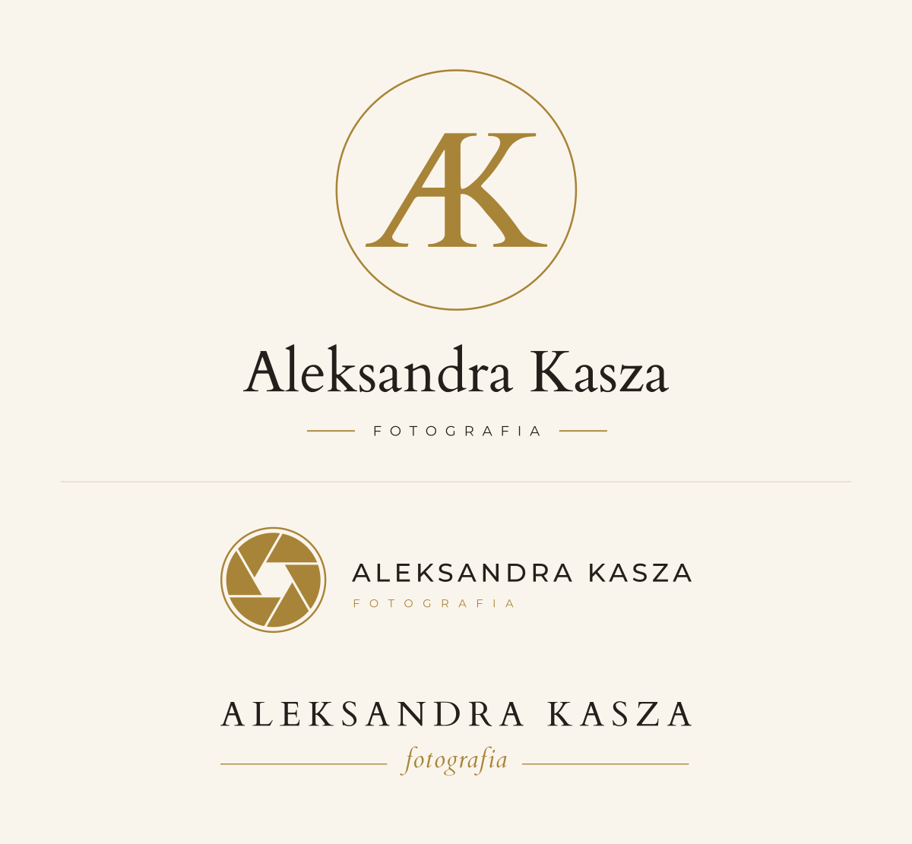

# Logo – Aleksandra Kasza Fotografia

Trzy propozycje odświeżonego logo. Każdy plik jest w dwóch formatach:

- **SVG**: wektor, do druku i dowolnego powiększania,
- **PNG**: z przezroczystym tłem, do internetu i mediów społecznościowych.

Tekst w logo jest zamieniony na krzywe, więc pliki wyglądają tak samo na każdym komputerze, bez instalowania fontów.

## Kierunek 1 · Klasyczny monogram (polecany)

Monogram AK w cienkim okręgu, w którym A i K mają wspólną pionową kreskę. Nazwisko jest złożone krojem Cardo, a „FOTOGRAFIA” krojem Montserrat.

Pliki: [kierunek-1-monogram](kierunek-1-monogram/)

## Kierunek 2 · Przysłona

Sześciolistkowa przysłona zbudowana geometrycznie oraz napis bezszeryfowy w układzie poziomym.

Pliki: [kierunek-2-przyslona](kierunek-2-przyslona/)

## Kierunek 3 · Minimalistyczny

Sam napis: wersaliki Cardo oraz „fotografia” kursywą.

Pliki: [kierunek-3-minimalistyczny](kierunek-3-minimalistyczny/)

## Który plik do czego

| Plik | Zastosowanie |
| --- | --- |
| `logo-kolor` | podstawowa wersja na jasne tło |
| `logo-ciemne-tlo` | wersja na ciemne tło |
| `logo-biale` | znak wodny na zdjęciach |
| `logo-jednokolorowe` | grawer, tłoczenie, pieczątka (tylko kierunek 1) |
| `logo-poziome` | nagłówek strony, stopka maila (tylko kierunek 1) |
| `znak`, `znak-ciemne-tlo` | awatar w mediach społecznościowych, ikonka strony |

Wersje `logo-biale` i `logo-ciemne-tlo` są jasne, więc na białym podglądzie GitHuba mogą być słabo widoczne. Tak ma być: przeznaczone są na zdjęcia i ciemne tła.

## Kolory

| Kolor | HEX |
| --- | --- |
| Złoto | `#A88438` |
| Złoto na ciemne tło | `#C9A55A` |
| Grafit (tekst) | `#23201C` |
| Krem (tło) | `#FAF5EC` |

## Kroje pisma

[Cardo](https://fonts.google.com/specimen/Cardo) i [Montserrat](https://fonts.google.com/specimen/Montserrat). Oba są darmowe na licencji SIL Open Font License, także do użytku komercyjnego, więc można ich używać na stronie i w materiałach drukowanych.
